# adraw

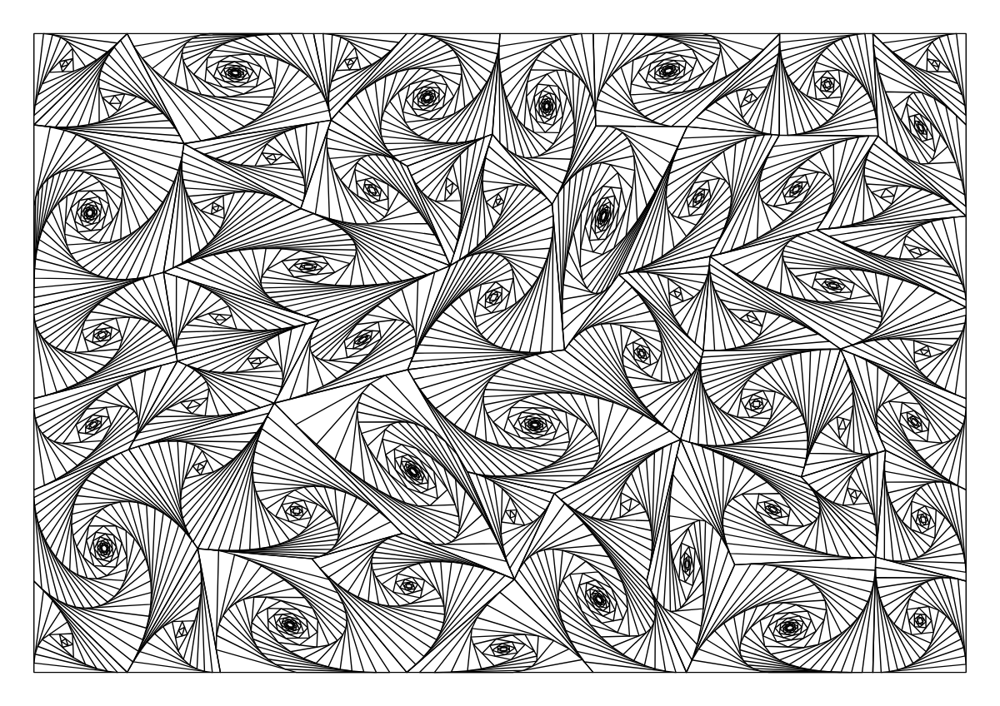

**Try it in your browser: [klmn.xyz/tools/adraw](https://klmn.xyz/tools/adraw/)** —
no install, the engine runs locally as WebAssembly.

A modular system for generating controllable graphics. Three independent layers:

```
 UI                  Engine                    Renderer
 ──                  ──────                    ────────
 web          →      patches            →      SVG
 CLI                 tangle, hatch             G-code
 MIDI (later)        ...                       another patch's border
 CV (later)
```

Each layer only knows the contract either side of it. A patch does not know what
will render it; a renderer does not know what generated its input.

## Patterns

Every image is real output, rendered by `make readme-images`.

| | | | |
|:-:|:-:|:-:|:-:|
| 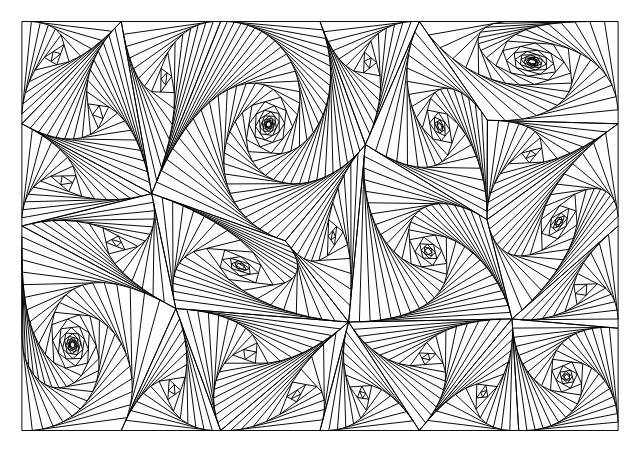<br>`tangle` | 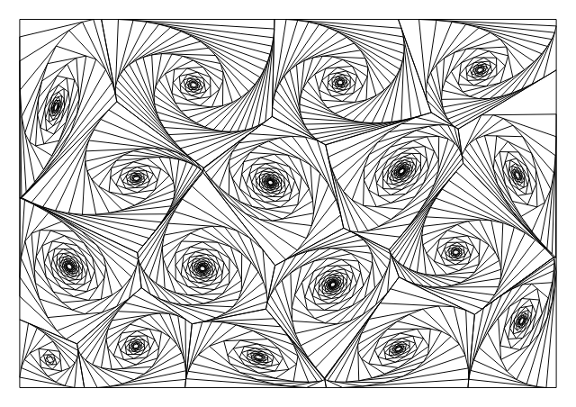<br>`vortex` | 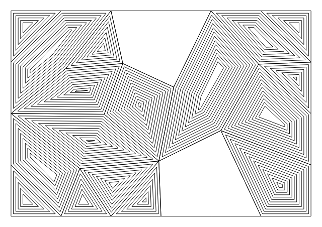<br>`contour` | 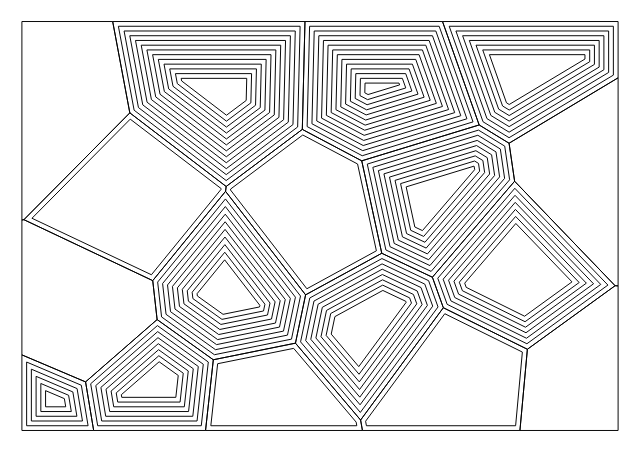<br>`cellwall` |
| 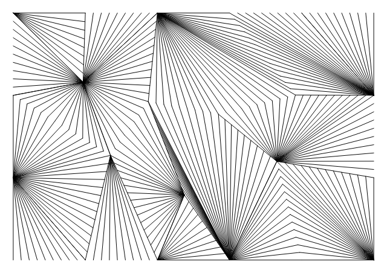<br>`fan` | 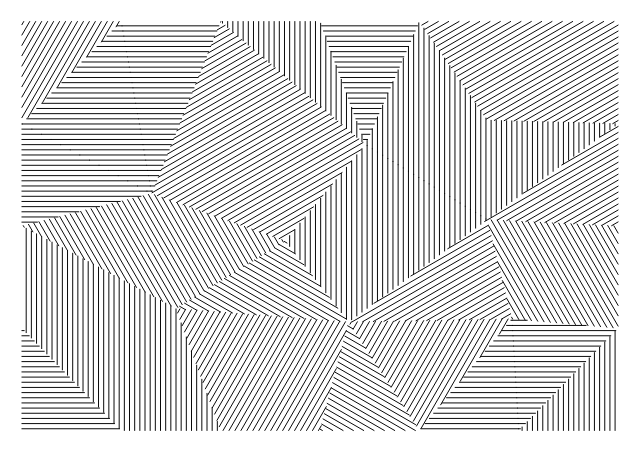<br>`hatch` | 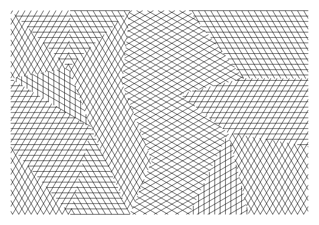<br>`crosshatch` | 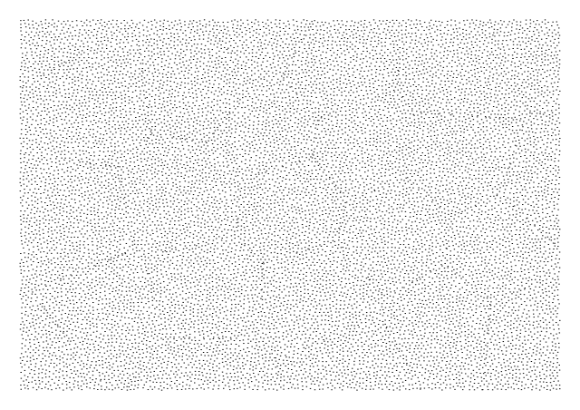<br>`stipple` |
| 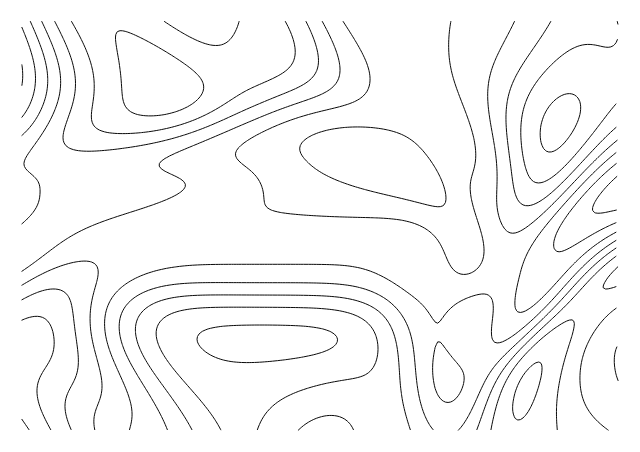<br>`topo` | 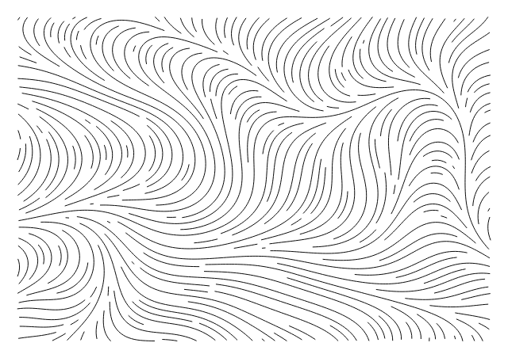<br>`flow` | | |

## Quick start

```bash
make serve        # web UI at http://localhost:8080
```

The landing page is a gallery: categories, then a tile per patch showing what it
draws. Every thumbnail is generated by the patch it names, so the tiles cannot
go stale. Click one to open the editor, where dragging a slider redraws live —
generation is a few milliseconds, so there is no render button. The address bar
mirrors every setting, so any result you like is a shareable link, and a link
with no `?patch=` opens the gallery.

### Page size

The Page control sets the sheet — presets from A5 to A3, a rotate button, or
type any size in millimetres. It updates live and stays put when you switch
patches.

It is deliberately **not** a patch parameter. Page shape is a property of the
paper, not of the pattern: the same drawing makes sense on A4 or on a square.
So it travels as its own `Request` field beside the seed, which also stops a
control surface from ever mapping a MIDI knob onto the paper size.

```bash
./adraw render --patch topo --page 210x297 --out portrait.svg
curl 'localhost:8080/api/render?patch=topo&page=210x297'
```

`Page` is separate from `Border` for a concrete reason: a border overrides the
patch's own margin, so routing page size through it would have silently killed
the margin control. `Page` sets the sheet and the patch still insets its margin
within it; `Border` overrides both, for drawing inside an arbitrary shape.

### Printing

Ctrl/Cmd-P, or the Print button, puts only the drawing on the page — no header,
no controls, no background.

It prints **vector SVG at true size**, not the canvas. A canvas prints as raster
at roughly screen resolution, which for millimetre-precise line work would mean
a soft, wrongly scaled page; the SVG carries physical mm dimensions and an
`@page` rule matched to the drawing, so a 297x210 drawing comes out at exactly
297x210 with crisp lines. Print at 100% scale — any "fit to page" setting
defeats it.

The SVG is built on `beforeprint` rather than kept up to date. Injecting a few
thousand `<path>` elements costs 50-100ms of DOM work, and paying that on every
slider tick would undo exactly what drawing to a canvas bought.

### Tuning the gallery

Categories and tile previews live in `adraw.json`, not in Go, so the page can be
tuned by eye — edit, refresh, look again — with no rebuild. The file is re-read
on every request.

```json
"tangle": { "category": "cells", "preview": { "seed": 3, "values": { "cell": 46 } } }
```

`preview` applies to the tile only; the editor still opens the patch at its real
defaults. Tiles are small, and most patches drawn at working density read as a
grey rectangle at that size, so the tile usually wants coarser settings than the
drawing does.

Everything in the file is optional. A patch it does not mention still appears,
in the default category, previewed with its own defaults — so registering a
patch remains enough to make it show up everywhere. Point elsewhere with
`adraw serve --config path.json`.

Or from the command line:

```bash
make build

./adraw list                  # available patches and renderers
./adraw params tangle         # a patch's tunable controls

./adraw render --patch tangle --seed 42 --out out.svg
./adraw render --patch tangle --seed 42 --set cell=14 --set spacing=0.8 --out fine.svg
./adraw render --patch tangle --seed 42 --out plot.nc     # G-code for a plotter
```

The renderer is inferred from the output file's extension.

## The layers

### UI

Sends a seed, an optional border polygon, and a set of named numeric values.
There are two so far — the web page and the CLI — and **neither carries any
per-patch knowledge**. Both discover each patch's controls from its `ParamSpec`
list, so a newly registered patch appears in both with working, labelled
controls without either one changing.

That same property is what makes MIDI and CV front-ends possible. Every
parameter is a `float64` in a declared `[Min, Max]`, so a MIDI CC maps in as
`FromNormalized(cc/127)` and a CV input as `FromNormalized(volts/10)` —
mechanically, for any patch.

#### The JSON API

`adraw serve` exposes the universal contract every future control surface
speaks. The browser page is simply its first client.

| Endpoint | Returns |
|---|---|
| `GET /api/gallery` | landing-page categories and their tiles |
| `GET /api/patches` | every patch with its description and full parameter list |
| `GET /api/renderers` | available output formats |
| `GET /api/render?patch=…` | the drawing as JSON geometry |
| `GET /api/export?patch=…&format=svg` | a finished file, travel-optimized |

Both drawing endpoints also accept `page=WxH` for the sheet size in millimetres,
and `border=x0,y0,x1,y1,…` to draw inside an arbitrary convex polygon instead.

Parameters are addressable two ways — by real value or normalized:

```bash
curl 'localhost:8080/api/render?patch=tangle&seed=7&cell=30'      # millimetres
curl 'localhost:8080/api/render?patch=tangle&seed=7&n.cell=0.45'  # 0..1
```

The `n.` form is what a MIDI CC or CV input naturally produces, and the server
maps it onto whatever range the patch declared — so such a client never needs to
know a patch's units or bounds.

Two rules keep the layers honest:

- **`/api/render` returns data, never a rendered format.** Converting a frame to
  SVG or G-code is the renderer layer's job, exposed separately at
  `/api/export`. Serving SVG from `/api/render` would hand a MIDI client XML it
  has no use for. `/api/export` runs the real renderers, so a download is
  byte-identical to the CLI's output for the same parameters.
- **Patches describe themselves.** `/api/patches` is assembled from each patch's
  own `ParamSpec` list. There is deliberately no config file of parameter
  definitions: it would be a second copy of the same truth, free to drift, and
  nothing could check that it listed the parameters the patch actually reads.

### Engine

Patches turn a seed and parameters into polylines.

Two families so far.

**Field-based** — sample a noise field over the page and trace it. No cells; a
handful of long flowing curves rather than thousands of short strokes.

| Patch | Draws |
|---|---|
| `topo` | contour lines of a noise landscape, like a topographic map |
| `flow` | streamlines following the field's direction, like iron filings |

They are perpendicular views of the same kind of landscape: `topo` traces the
level sets of a scalar field, `flow` traces the flow direction of one.

**Cell-based** — divide the page into convex cells, draw something in each.

| Patch | Draws |
|---|---|
| `tangle` | the vortex pattern, with `tess` and `style` exposed as sliders — all twelve combinations from one patch |
| `contour` | nested outlines stepping inward from each cell's edges |
| `cellwall` | the same in organic Voronoi cells, reading as thick cell walls |
| `vortex` | spirals in Voronoi cells, rounder than `tangle`'s triangles |
| `fan` | rays from one corner of each cell, as shaded wedges |
| `hatch` | parallel ruled lines, each cell at its own angle |
| `crosshatch` | two crossing sets of ruled lines, for a denser tone |
| `stipple` | blue-noise dots through organic cells |

The seven after `tangle` live in `patches/cells` and are the same pipeline with
their tessellator and fill fixed — presets, not reimplementations. Each exposes
only the controls that mean something for its combination, and declares its own
sensible spacing range.

Patches self-register via `init()`. See [patches/README.md](patches/README.md).

### Renderer

Takes a `drawing.Frame` and produces output.

- **`svg`** — one `<path>` per polyline, `viewBox` in millimetres so one unit on
  screen is one millimetre on paper.
- **`gcode`** — pen-up travel between paths, pen-down along each.

## Plotter travel

Patches emit paths in generation order, which is close to worst case for a
plotter. `pkg/optimize` reorders them, and exploits two freedoms that leave the
drawing untouched: an open path may be reversed, and a closed ring may start at
any of its vertices — the latter being the dominant win, since `tangle` output
is almost all closed rings.

On `tangle` at defaults: **9199 mm of pen-up travel becomes 3279 mm**, from 19%
of the 48.5 m drawn down to 7%.

It runs on CLI `render` and on `/api/export`, but deliberately not on
`/api/render` — the canvas preview does not care about stroke order, and paying
for the pass on every slider tick would spoil the live feel.

## The data contract

Everything a patch produces is **polylines in millimetres**:

```go
type Frame struct {
    Bounds Rect
    Paths  []Path        // Path = []Vec2 plus a Closed flag
    Meta   map[string]string
}
```

That is the lowest common denominator serving every renderer category: an image
renderer strokes the paths, a G-code renderer travels and draws along them, and a
chaining renderer can feed a `Path` straight back in as another patch's border.

No colour, no stroke width — a pen plotter has one pen, and renderers that want
style apply their own.

`Meta` records the patch, seed and resolved parameters into every output file, so
any drawing can be reproduced from the file itself.

## How the field patches work

1. **Simplex noise** (`geom.Noise`), summed over octaves as fBm. Simplex rather
   than Perlin because Perlin's square gradient lattice leaves faint
   axis-aligned streaks — invisible in a texture, but obvious regular stripes
   once you trace level sets or streamlines through the field.

2. **`topo`** extracts isolines with marching squares (`geom.Contour`), then
   stitches the per-cell segments back into long polylines. Without that
   stitching a single contour would be thousands of disconnected stubs: correct
   on screen, hours of pen lifts on a plotter.

3. **`flow`** traces streamlines (`geom.Streamlines`) with midpoint integration,
   stopping each line when it approaches an existing one. That separation rule
   is what keeps a flow field legible — without it every line converges on the
   same attractors and the drawing turns to mush.

## How `tangle` works

1. **Blue-noise sampling** (`geom.PoissonDisk`) spreads points through the border
   with a guaranteed minimum separation. It seeds the border's edges first, which
   makes the convex hull of the point set equal the border — so the triangulation
   tiles it exactly with no clipping, and no point can sit just inside an edge.

2. **Delaunay triangulation** (`geom.Tessellate`) turns those points into cells.
   Delaunay maximizes the minimum angle over all triangulations, so fed
   blue-noise points, sliver cells are structurally excluded rather than filtered
   out afterwards. Adjacent cells are then optionally fused into quads and
   pentagons for shape variety.

3. **Fill** — `style` picks how each cell is drawn. The default `geom.Spiral`
   fills it with rings inscribed by walking
   a fraction along every edge. That offset walk is what separates it from
   `geom.Inset` (the `contour` style, which offsets each edge along its own
   normal instead): the rings twist as they shrink, sweeping the interior into a
   vortex. The fraction is solved per ring by bisection so the gap between rings
   stays a real millimetre distance you set from your pen width.

## Static hosting (WebAssembly)

```bash
make wasm          # writes out/web/
make serve-wasm    # preview it at http://localhost:8081
```

`out/web/` is the whole UI as static files, with no server behind it: copy it
into any static site (for a Hugo site, `static/adraw/`) and it runs at that
path entirely in the browser.

It is not a reimplementation of the API. `cmd/adraw-wasm` compiles the same
`web.Handler` to WebAssembly, and `wasm.js` routes the page's `fetch('/api/…')`
calls into it, so `app.js` cannot tell the difference and responses are
byte-identical to an amd64 `adraw serve`. (arm64 builds can differ in the last
bits, because Go fuses multiply-adds there, which occasionally tips a near-tie
in the travel optimizer; the strokes are the same.)

`adraw.json` is fetched as a plain file beside the page, so the deployed
gallery can still be tuned without a rebuild. The module is about 8 MB, 2 MB
gzipped, downloaded once and then cached. Hosts that do not send
`application/wasm` still work, just without streaming compilation.

### Publishing to klmn.xyz

```bash
make deploy-klmn              # check, build, test, commit, push
NO_PUSH=1 make deploy-klmn    # stop after the commit
```

The tool lives at [klmn.xyz/tools/adraw/](https://klmn.xyz/tools/adraw/). Its
page is native to that site — its layout, design system and tests live in the
klmn.xyz repo — so the deploy ships **only the engine**: `adraw.wasm`,
`wasm_exec.js`, `wasm.js` and `adraw.json`. The page discovers patterns and
their controls from the engine, so a new or retuned patch needs nothing else.

`scripts/deploy-klmn.sh` expects the checkout at `../klmn.xyz` (override with
`KLMN=`), on `main`, with `npm install` done in its `test/`. It refuses to
overwrite uncommitted edits to those four files, does nothing when the build
is byte-identical, and runs the page's real-Chrome tests against the new
engine before committing. Netlify publishes on push.

## Layout

```
pkg/          stable public API — what a patch author touches
  drawing/    Vec2, Path, Frame — the engine↔renderer contract
  patch/      Patch interface, ParamSpec, registry
    patchtest/  conformance suite every patch runs
  render/     Renderer interface, registry
  geom/       the shared toolkit: sampling, tessellation, fills, polygon
              maths, noise, contouring, streamlines
  optimize/   Frame→Frame passes (plotter travel ordering)
internal/     implementation details
patches/      tangle, hatch
renderers/    svg, gcode
ui/web/       JSON API + embedded browser client (gallery + editor)
  wasm/       shim that runs the API in the browser for static hosting
adraw.json    gallery categories and tile previews, tunable without a rebuild
cmd/adraw/    CLI
cmd/adraw-wasm/  the web API as WebAssembly
plans/        design documents
scripts/      deploy-klmn.sh, readme-images.sh
docs/images/  README examples, generated by `make readme-images`
```

`geom` is public rather than internal on purpose: it is the toolkit patches are
built from, not an implementation detail of any one of them. **If you write
general-purpose geometry inside a patch, it belongs in `geom` instead** — then
the next patch inherits it for free.

## Testing

```bash
make check     # vet + tests
```

Every patch runs `patchtest.Verify`, which checks determinism, seed sensitivity,
bounds containment, NaN-freedom, parameter hygiene, and survival at the extreme
of every declared range — the values a control surface will actually send. Adding
a check there holds every existing patch to it immediately.

## Not yet built

- Non-convex and SVG-path borders (currently convex only)
- MIDI and CV front-ends — the JSON API's normalized form is ready for them
- Real-time and animation — `Generate` returns one complete frame
- Patch chaining — the data format supports it; nothing wires it up yet
- Truchet tiles and differential growth — the remaining ideas from plan 002.
- Composing one patch's regions as another's borders. `patch.Regioner` exists
  and the cell patches implement it; the patch that consumes it waits until
  there is a real second use.

## License

MIT — see [LICENSE](LICENSE).
